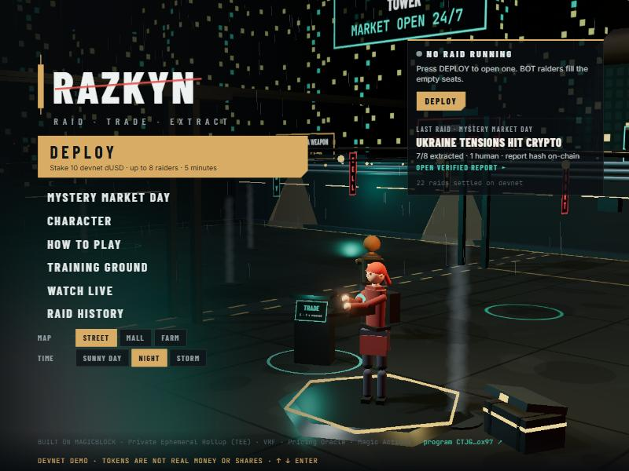
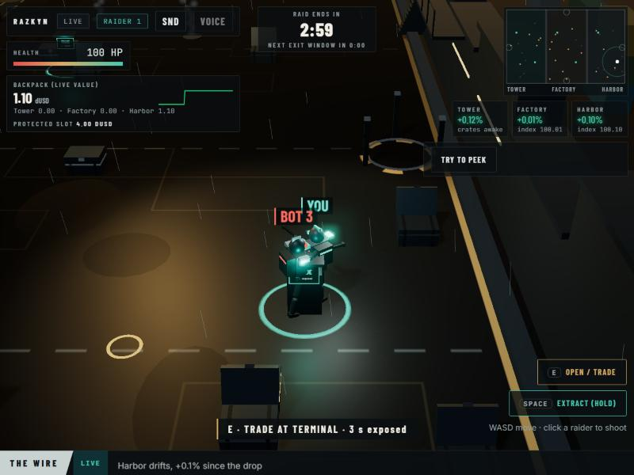
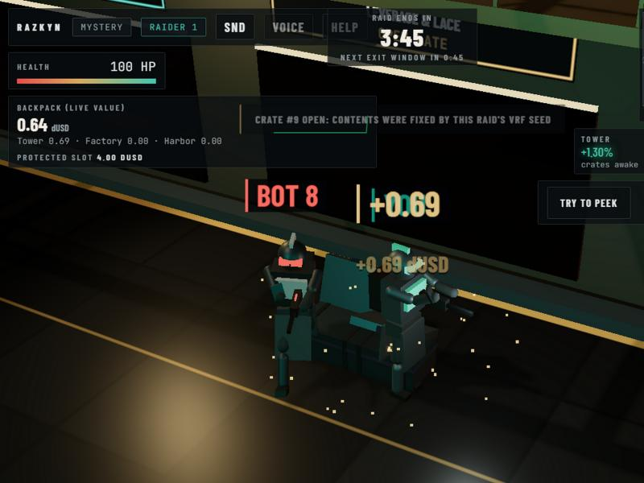
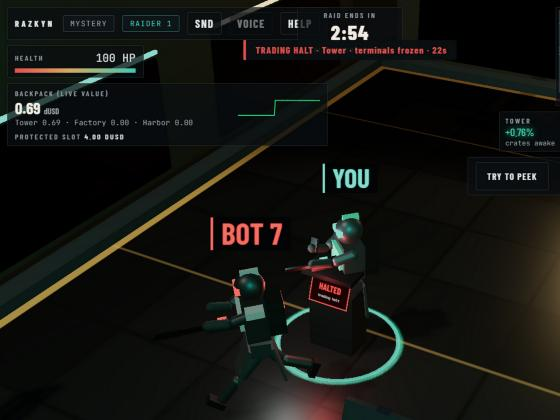
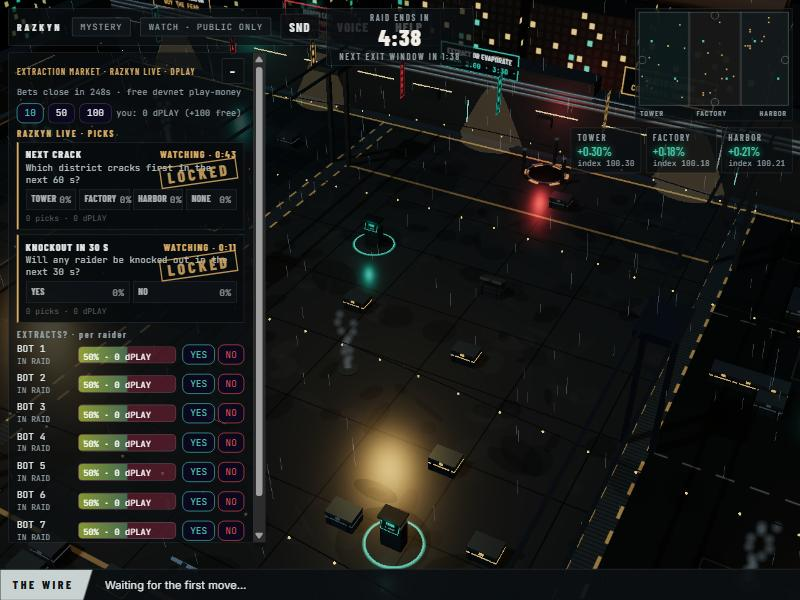
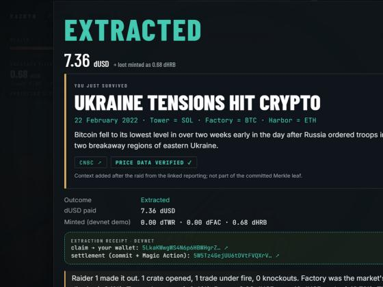
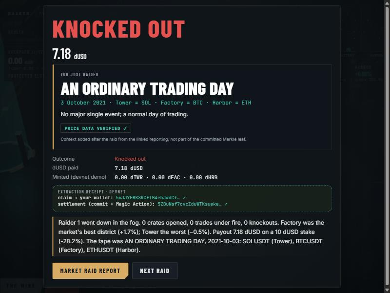
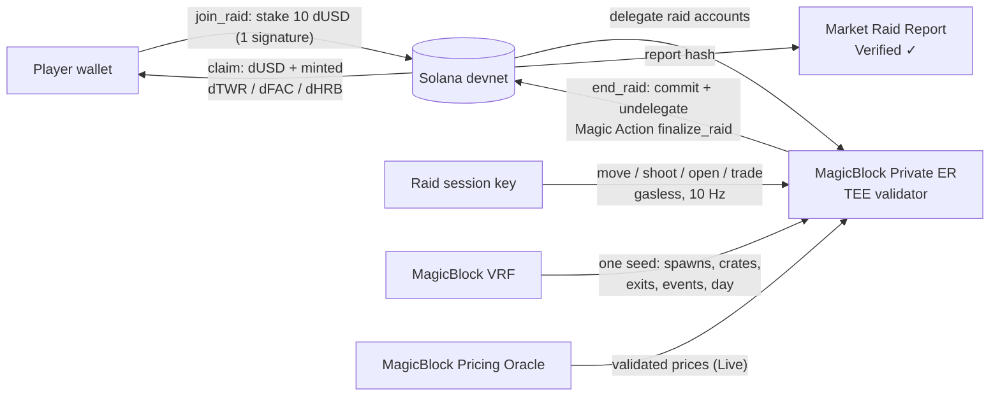
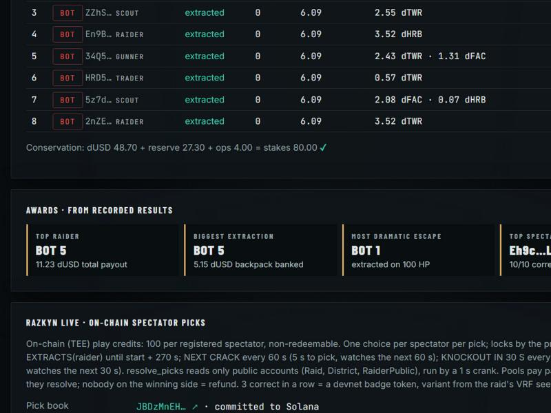

# R A Z K Y N — RAID. TRADE. EXTRACT.

**A market-driven multiplayer extraction game on Solana, built on MagicBlock.**
MagicBlock Solana Blitz v10 · Entertainment Finance · Games · DeFi · Privacy



> **In RAZKYN, a market crash changes the map while you're still carrying loot.** You can rebalance at a terminal, but doing so reveals your position. Survive the raid and your extracted rewards settle to your Solana devnet wallet.

**[Play it now](https://razkyn.vercel.app)** · **[A verified raid report](https://razkyn.vercel.app/report/1795735156066)** · **[Program on Solana Explorer](https://explorer.solana.com/address/CTJGR8bj7HAzFja1YGjvkc9wP2JrFnachqMLeoniox97?cluster=devnet)** · **[Submission](SUBMISSION.md)**

No setup needed: open the site, press **DEPLOY → OPEN RAID**, press **Use a dev wallet** (or connect Phantom on devnet) and join. One signature; the game server covers the join fee for an empty devnet wallet.

> Devnet demo. dUSD, dTWR, dFAC, dHRB and dPLAY are transferable devnet game tokens, not shares and not real money. BOT raiders are labelled BOT everywhere.

---

## At a glance

| | |
|---|---|
| **32 raids** settled on devnet | each with a hash-checked report on-chain ([raid history](https://razkyn.vercel.app/history)) |
| **8 raiders, 5 minutes, 10 ticks/s** | movement, combat, looting and trading run gasless on MagicBlock's Private Ephemeral Rollup (TEE) |
| **1 wallet signature** | a raid-scoped session key signs every move after that: no popups, no fees |
| **3 market modes** | a real past crypto day (Mystery), live SOL/BTC/ETH, live NVDA/TSLA/SOL from MagicBlock's Pricing Oracle |
| **0 peeks** | sealed crates, other raiders and the secret day are refused by the TEE, live, from your own browser |
| **28 / 28** MagicSVM tests · **6** devnet test suites | conservation, cheats, privacy, settlement recovery, load, report tamper |

---

## The problem

- **Extraction games are huge, but their loot is worthless outside the game.** You grind for hours for items you can never own.
- **Trading apps are real, but they feel like casinos.** A chart and a buy button teach nothing and reward impulse.
- **Fantasy stock games teach the market, but nothing you win is real.**

And building the honest version is hard: a game server can peek at hidden loot, rig crates and backdate moves; a plain blockchain is too slow for live combat (~400 ms confirmations), charges a fee for every step, and makes every backpack public.

## The solution

RAZKYN turns the market into a map you physically survive.

| The market... | ...becomes gameplay |
|---|---|
| Three assets | Three districts: **Tower**, **Factory**, **Harbor** |
| A district rises 2% | It glows and **wakes dormant loot crates** |
| A district falls 2% | Its floor **cracks into hazard tiles** that drain 10 HP/s (−5%: twice the area) |
| Your portfolio | Your **backpack**, whose dollar value ticks live with the prices |
| Rebalancing | A **terminal trade** that takes 3 s and **exposes your position** to everyone |
| Taking profit | **Extracting**: stand on an open exit for 5 s and the bag settles to your wallet |
| A crash day you lived through | **Mystery Market Day**: the city replays a real day; you learn which one only after the raid, with a Merkle proof |

Everything that decides money runs on-chain: movement, damage, line of sight, crate contents, market events and payouts come from program rules and VRF, never from the client.

---

## How a raid plays

| | |
|---|---|
|  |  |
| **Trade under fire.** A terminal trade exposes your position for 3 s; a hit cancels it. | **Sealed crates.** Contents were fixed by the raid's VRF seed and stay hidden in the TEE until opened. |
|  |  |
| **Market events.** TRADING HALT, RATE SHOCK and EARNINGS SURPRISE, drawn from VRF and committed by hash before the raid. | **Watch and pick.** Spectators make on-chain picks (who extracts, which district cracks next, a knockout in 30 s), resolved by the program. |
|  |  |
| **Extract and get paid.** The real day is revealed ("Ukraine tensions hit crypto, 22 Feb 2022"), the price data is verified against the on-chain Merkle root, and the receipt links your claim and the settlement. | **Knocked out still pays.** You keep the protected slot plus a share of the loot nobody extracted. |

<sub>In-raid screenshots were taken on 26 Nov, before the protected slot changed from 4.0 to 2.0 dUSD (DECISIONS #41) and before cover blocks and BOT combat were added; the end screens and watch view are unchanged.</sub>

**The loop, step by step**

1. **Lobby.** Press DEPLOY, pick a mode and a class (Raider, Scout, Trader, Gunner), join with one signature. Your 10 dUSD entry splits into **2.0 protected** (always yours), **7.5 into the loot crates**, **0.5 fee**. Empty seats become labelled BOTs.
2. **Drop.** Spawns, crate contents, exits, two market events and the Mystery day all come from one VRF seed.
3. **Loot, trade, fight.** WASD to move, E to crack a crate (2 s) or trade at a terminal (3 s, exposed), click to shoot (6 tiles, 34 damage), cover blocks stop shots and movement. BOTs hunt you inside their own fog of war.
4. **Extract.** Exits open at 2:00, 3:30 and 4:30. Hold Space on one for 5 s.
5. **Settle and verify.** The raid commits to Solana with a Magic Action, every raider is paid automatically, the Mystery day is revealed with a Merkle proof, and the Market Raid Report checks its own hash against the chain.

---

## Why it needs MagicBlock

| Requirement | Without MagicBlock | With MagicBlock in RAZKYN |
|---|---|---|
| Live combat at 10 ticks/s | ~400 ms confirmations, a fee per step | **Ephemeral Rollup**: gasless moves and shots at 100 ms ticks |
| Hidden loot, fog of war, a secret day | Everything on a public chain is readable | **Private ER (TEE) + permissions**: each raider reads only their own state; sealed crates and the day are keeper-only. Try to Peek shows the refusal |
| Fair crates and spawns | The operator picks the outcome | **VRF**: one verifiable seed per raid drives every random outcome |
| Real market moves | A server feeds whatever prices it likes | **Pricing Oracle**, read and validated on the TEE (key, owner, freshness, slot) |
| No popups mid-fight | A wallet signature per action | **Raid-scoped session keys**: one signature to join; the key can never move tokens |
| Real payouts | Custodied points | **Commit + Magic Action**: one settlement commit, then `finalize_raid` on Solana; claims pay each wallet once, with a recovery path anyone can trigger |



---

## Proof: check the chain, not our word

### 1. A raid played on the live site (27 Nov)

Raid **[1795735156066](https://razkyn.vercel.app/report/1795735156066)** (Mystery, 1 human + 7 BOTs). Joined as a Gunner, pressed READY to drop early, Try to Peek refused three private reads, BOTs fought and knocked the human out, and the human was still paid.

| Step | Evidence |
|---|---|
| Commit + Magic Action (`finalize_raid`) | [`3LASRLjY…`](https://explorer.solana.com/tx/3LASRLjY3cTpr1F2a52phHd7meE6xaYVmJiA82xc4qYPPCXTYkVioqNr56icZQ38rgv53x1LSq77ACsLvKE7BBCK?cluster=devnet) |
| Claim to the player's wallet | [`3Q6nbF5f…`](https://explorer.solana.com/tx/3Q6nbF5fi7346DGeNK4vE4fEi2xqPSQBLswFBLpNVN4RhNwhM1ipMAeUY2VXzTQohjk6yAxS2HGLqvpQzCvqXeMz?cluster=devnet): dUSD **8.103408 → 16.143201 (+8.04)** |
| Second claim of the same seat | refused: the seat's Claim record already exists, so it can be paid only once |
| Report hash posted on-chain | [`4gwbYS6a…`](https://explorer.solana.com/tx/4gwbYS6aRkD9GJ7kDQDUQhLDGV28wsvGQFz1uXoJ1S3ycXjJmuK4NMJ7K2MGAN3BipVexrS7AfuaQ4tAfW5Uib2s?cluster=devnet) · report page: hash ✓, Merkle proof ✓ vs `Raid.day_root`, event plan ✓ vs `Raid.event_plan_hash` |
| Gameplay load | 2,794 / 2,794 tick transactions confirmed, p95 374 ms, 0 stalls over 1 s |

### 2. Every MagicBlock piece, in one raid

Raid **[1795718682996](https://razkyn.vercel.app/report/1795718682996)** (Mystery, 1 human + 7 BOTs, 26 Nov).

| Proof | Signature |
|---|---|
| Delegation to the TEE validator `MTEWGuqx…` | [`3jFMd4D8…`](https://explorer.solana.com/tx/3jFMd4D87AgVoqDsbPBbDrrTdSAb7KPsTHjP3rWBBaUPvVRNRjD1mcN5GLC5fpjFoVDqf2u3ufpnYbEZM17mwrF?cluster=devnet) |
| Gameplay transaction on the TEE (`end_raid`) | `4YwKSJZZbkhfP8RtnyZktrK6CS4J1dqYeZPxiKVPgtcacRavt4VvMpa7sx9aUHqbeen8ZQr3Jx1hkUNZoPnG7tLC` (readable only with a TEE token) |
| VRF request (TEE) | `2zP4RK9S7r3pXLmrKm7pckQ4mJfs2S7Kpcv9iuxQc9rDt9s1X6Zhb3WyifMotE3URXFkYDekvGGY1AZ7xKmsNADi` (devnet-tee hides the callback signature; the seed's effects are verified on the report page) |
| Commit + Magic Action | [`5h5j3x6E…`](https://explorer.solana.com/tx/5h5j3x6E3Gfb9wujCmN2xJQavuYC1xSxU3PE2S2KQieVh4ym65czeC1AoVtoYopJX5pk4A73BCXKVaqAXfxyhmhj?cluster=devnet): commit → `FinalizeRaid` → "settled … via 1" → undelegate |
| Claim | [`2fmRq5Py…`](https://explorer.solana.com/tx/2fmRq5PyL4cUbxreapR5yDAj2vyxEUjw3SZvAtyChab64L55EXjD3sHBdvc9DQH4rWEvQdn5FzSbkvzwEaC6vzDT?cluster=devnet): 6.61 dUSD (2.00 protected + pro-rata share) |
| Report hash on-chain | [`39Dso3T3…`](https://explorer.solana.com/tx/39Dso3T3ibb1YnxT4V6iXuivpko99HjwEYiitYmydaRBYr88d9TaVLhtu9U7uE6SLJu28JKMBUTPRrzrCfQ9JbS7?cluster=devnet) |
| Fee vault | [`3gA9REuL…`](https://explorer.solana.com/address/3gA9REuLgMoe2RTFPucfH2YQbcqFqYyFsfuCxZAwUYbM?cluster=devnet) receives 0.5 dUSD per raider in `finalize_raid` |

### 3. Two independent wallets, both paid

Raid **[1795728660174](https://razkyn.vercel.app/report/1795728660174)**: two separate devnet wallets joined from two browsers.

| Wallet | Claim | dUSD before → after |
|---|---|---|
| `4Stk…8iJr` | [`3jbABBfK…`](https://explorer.solana.com/tx/3jbABBfKpT7RHp8V93yRFBYvuvuTyrZv5jB9sK3Hu1uxHP6TXh3khEsMHopAueagHsTdWxw293FaPQk4mmL7uhcL?cluster=devnet) | 8.144396 → 16.247809 (+8.10) |
| `FG8i…qwCW` | [`2c3L68yK…`](https://explorer.solana.com/tx/2c3L68yKkq5sphWqJ2DJEGqtUoGui3HcAcdwPKJVQhAUvFKUZu3pfp3iFbTjNmddcwhk2vGei4uhfX1GkaKBPx6V?cluster=devnet) | 0.000000 → 8.103408 (+8.10) |

### 4. The money always adds up



The program asserts `payouts + reserve + ops == stakes` in integer base units at settlement, and every report shows it (above: dUSD 48.70 + reserve 27.30 + ops 4.00 = stakes 80.00 ✓). Extracted backpacks are minted as dTWR / dFAC / dHRB, backed by dUSD moved into a per-raid reserve at that raid's final prices.

### Verify it yourself

1. **Any payout, from public chain data:** `npx tsx scripts/payout-proof.ts <raid_id>` prints the settlement, each human's claim, their token balances before and after (read from the claim transaction itself) and a simulated second claim that the program refuses. No keys needed.
2. **Any report:** open `https://razkyn.vercel.app/report/<raid_id>`; it recomputes the report hash and checks it, the Merkle proof and the market-event plan against the chain. Edit one number in the JSON and it says **Mismatch**.
3. **Privacy, live:** in any raid press **TRY TO PEEK**. Your browser sends real reads of a sealed crate, another raider's private state and the raid secret to the TEE with your own token; all three come back refused.

### Tests

- **MagicSVM, 28 / 28** (local): full 8-raider raid settles and claims sum to escrow; same seed → same outcome; speed cheats and wrong signers rejected; `finalize_raid` / `claim` guards and no double pay; `verify_slice` rejects a wrong slice or leaf; randomized payout conservation; classes, a hit cancelling a trade, committed market events; on-chain picks (program-clock locks, public-only resolver, credits conserved, refunds); cover (moves and shots through cover refused).
- **Devnet:** privacy (test 8), spoiler scan of all client traffic (9), THE WIRE leak test (10), settlement recovery when the Magic Action is dropped (11), 10 Hz load for 300 s (12), report tamper → Mismatch (13). Evidence in [STATUS.md](STATUS.md) and `spikes/results/`.

---

## Features

- **Three modes:** Mystery Market (one of 23 real crypto days, committed by Merkle root before the raid), Live Crypto (SOL, BTC, ETH) and Live Markets (NVDA, TSLA, SOL), priced by MagicBlock's Pricing Oracle.
- **Combat with cover:** 100 HP, 34 damage, 6-tile range; 13 cover blocks the program enforces for movement and line of sight. **Classes:** Scout sees 10 tiles, Trader trades in 2 s, Gunner shoots 7 tiles every 400 ms.
- **BOTs that fight:** each BOT sees only its own fog view, shoots and hunts like a player under the same program checks, and paces its fights so knockouts build towards the exit windows.
- **Market events** from VRF: TRADING HALT, RATE SHOCK, EARNINGS SURPRISE.
- **THE WIRE**, an AI newsroom that narrates public facts only ("Shots fired: BOT 4 under fire, down to 66 HP", "Harbor slides −1.7% in 30s"), with a spoiler filter and optional voice. It is never a permission member, so it cannot leak private state.
- **Spectators:** RAZKYN LIVE on-chain picks with play credits and a session key, the dPLAY Extraction Market, spectator cameras and a `/overlay` view for streamers.
- **End screen:** settlement steps (ended → committed → settled → paid), extraction receipt, the sourced Mystery reveal, a debrief and a shareable raid card.
- **Also:** handles and READY (early drop), Tab inventory, M full map, Training Ground (offline), raid history, settings (graphics, FPS counter, sound, voice), phone support in landscape.

---

## MagicBlock stack

| Piece | How RAZKYN uses it | Where |
|---|---|---|
| Private Ephemeral Rollup (TEE, `devnet-tee`) | Every account a raid mutates is delegated to the TEE validator `MTEWGuqx…`; gameplay runs there at 10 ticks/s | `delegate_raid`, `programs/razkyn/src/instructions/lobby.rs` |
| Permissions (`EphemeralPermission`) | A raider's private state → their raid key + keeper; fog View → that raid key only; sealed crates and the raid secret → keeper only; public accounts have none | `tee_setup.rs`, `crates.rs` |
| `getAuthToken` | Client and keeper authenticate to the TEE; the client signs with the raid key and refreshes before expiry | `app/src/lib/chain.ts` |
| VRF (`#[vrf]` / `#[vrf_callback]`, ephemeral queue) | One seed per raid → spawns, crate placement and contents, exits, market events, Mystery day, spectator badge | `request_raid_vrf`, `vrf_callback_raid` |
| Pricing Oracle | SOL/BTC/ETH or NVDA/TSLA/SOL `PriceUpdateV3` feeds read on the TEE with key, owner, freshness and `posted_slot` checks | `market.rs` `read_feed` |
| Keeper ticks + crank | Permissionless, clock-gated `tick` at 10 Hz; spectator picks resolve every second through a `ScheduleCrankCpi` crank | `keeper/src/ticker.ts`, `picks.rs` |
| Magic Actions | `end_raid` commits and undelegates with `MagicIntentBundleBuilder` plus a post-commit `finalize_raid`; `settle_stuck_raid` recovers if the action is dropped | `settle.rs` |
| Raid keys | Burner key registered at `join_raid`, valid only for that raid's gameplay, never a token authority | `join_raid`, `require_can_act` |

SDK `ephemeral-rollups-sdk` 0.18.0 (Rust and npm), Anchor 1.0.2, Agave 3.1.9. Program `CTJGR8bj7HAzFja1YGjvkc9wP2JrFnachqMLeoniox97` (devnet); mints in `config/devnet.json`.

---

## Trust model and honest limits

- **The keeper is the game operator**, with the same trust as a game server: it creates raids, drives ticks, runs the BOTs, settles, claims for everyone and builds the report, and it can read private state.
- **It cannot change outcomes:** moves, hits, crate contents, market events, the Mystery day and payouts come only from program rules, the VRF seed and the committed Merkle root. Players send their own moves straight to the TEE. `tick`, `claim` and `settle_stuck_raid` are permissionless.
- **It could** leak private state it can read, delay its own transactions, choose when raids open, or run the keeper-settled dPLAY market dishonestly. BOTs are written to use only their own view and public data (`keeper/src/bots.ts`), but that is code you read, not a program rule.
- **A report hash** proves the report was not edited after posting; the on-chain parts (results, payouts, settlement, claims, Merkle proof, event plan) are checked against the chain; BOT activity in the report comes from the keeper's log.
- **Tokens:** minted assets are backed by dUSD in a per-raid reserve at that raid's final prices; there is no redeem instruction, and rounding can leave a reserve up to 0.000001 dUSD short per raider.
- **Known gaps:** the VRF callback signature is hidden by devnet-tee; THE WIRE runs on template lines until an `ANTHROPIC_API_KEY` is configured; Mystery days are crypto days only; under network jitter some pipelined moves fail the program's speed check, so walking is slower than the 6 tiles/s cap; not built: reload/ammo, sprint/dodge, weapon switching, items beyond classes, a tradable market for minted assets, replays.

---

## Run it

Prerequisites (pinned): Rust 1.89.0, Agave 3.1.9, Anchor 1.0.2, Node 24. Scripts run in WSL/Linux after `source scripts/env.sh`.

```bash
npm ci                                    # keeper, scripts, tests
scripts/build.sh                          # anchor build (program + IDL)
scripts/test-magicsvm.sh                  # MagicSVM suites (28 tests)
npx tsx keeper/src/serve.ts               # game server: opens a raid when a player presses DEPLOY
cd app && npm ci && npm run dev           # client on http://localhost:5173 (VITE_KEEPER_URL → the keeper)
npx tsx scripts/payout-proof.ts <raid_id> # verify any raid's payouts from chain data
```

**Deployment (judging):** client on Vercel (https://razkyn.vercel.app); keeper on a VPS as a systemd service behind HTTPS (`https://razkyn.16-61-50-207.sslip.io`: `/lobby`, `/lobby/open`, `/fund`, `/reports/:id`, `/wire/:id/stream`), one raid at a time, at most 4 per hour.

More: [SUBMISSION.md](SUBMISSION.md) (links and proof), [STATUS.md](STATUS.md) (what is done, with evidence), [DECISIONS.md](DECISIONS.md) (every change from the spec), [docs/demo-script.md](docs/demo-script.md) (2-minute demo).
